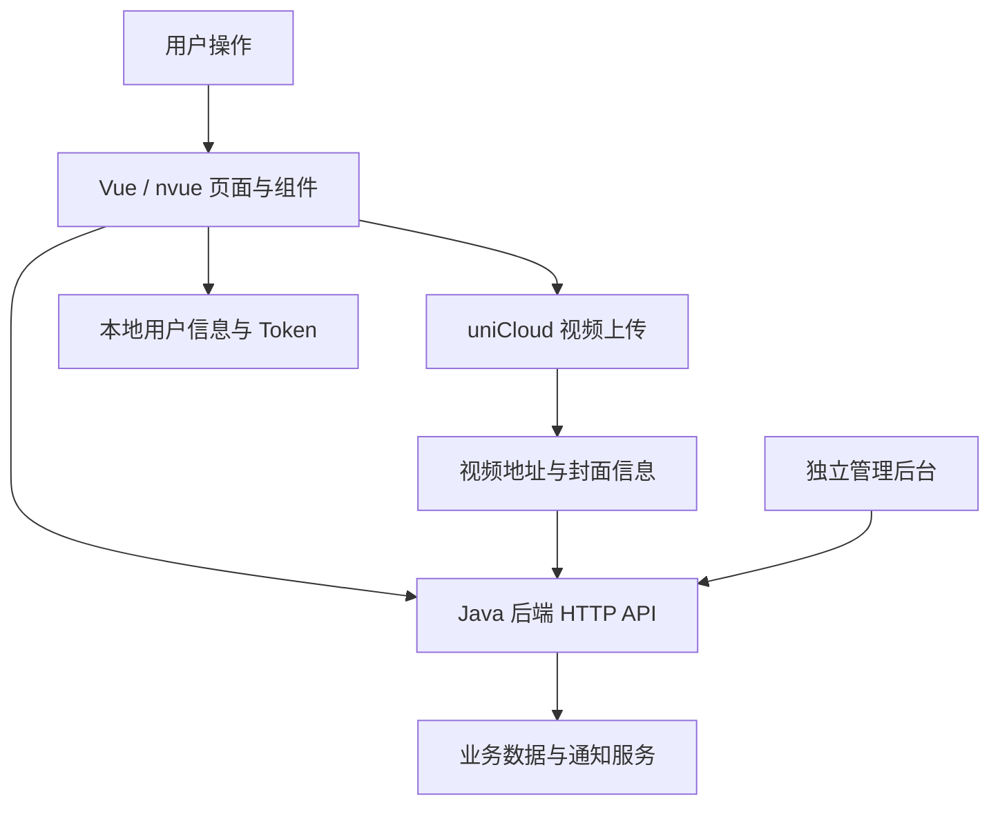

# ShayuVideo APP · 鲨鱼视频用户端

ShayuVideo 是一个仿抖音的短视频项目，围绕视频浏览与发布、评论点赞、关注关系、消息通知和举报申诉提供业务功能。**本仓库是基于 uni-app、Vue 2 和 nvue 开发的 APP 用户客户端。**

本 README 的目录、配置和运行方式均针对用户端。业务接口由独立 Java 后端提供，内容审核和管理操作由独立 Web 管理后台完成。

## 目录

- [项目组成与技术栈](#项目组成与技术栈)
- [架构与工程结构](#架构与工程结构)
- [系统功能框架](#系统功能框架)
- [核心业务流程](#核心业务流程)
- [快速开始](#快速开始)
- [配置说明](#配置说明)
- [运行与打包](#运行与打包)
- [接口联调与本地状态](#接口联调与本地状态)
- [常见问题](#常见问题)
- [功能边界与验证情况](#功能边界与验证情况)
- [相关文档与协作](#相关文档与协作)
- [许可证](#许可证)

## 项目组成与技术栈

| 工程与仓库 | 定位 | 主要技术 |
| --- | --- | --- |
| [ShayuVideo_APP](https://github.com/tangmyy/ShayuVideo_APP)（本仓库） | APP 用户客户端；本地目录为 `ShayuVideoAPP` | uni-app、Vue 2、nvue |
| [ShayuVideo_api](https://github.com/tangmyy/ShayuVideo_api) | Java 后端，提供业务接口 | Java 8、Spring Boot、MyBatis |
| [ShayuVideo_admin](https://github.com/tangmyy/ShayuVideo_admin) | Web 管理后台 | Vue 3、Vite、Element Plus、Pinia |

| 用户端组件 | 用途 |
| --- | --- |
| uni-app、Vue 2 | 页面、生命周期与组件开发 |
| nvue | 视频流、消息及个人中心等页面的原生渲染 |
| uni-app video 组件 | 视频播放和控制 |
| uniCloud | 客户端直接上传视频文件 |
| uni-popup、uni-transition | 评论、分享、举报等弹层及过渡效果；仓库中的部分组件含业务定制 |
| Sansnn-uQRCode | 二维码相关组件 |
| 本地地区数据 | 省市区选择及个人资料展示 |

当前是 HBuilderX 形式的工程，根目录 `package.json` 没有 `dev`、`build` 等 scripts，不能直接按 Vite 项目执行 `npm run dev`。uni-app 支持多个目标平台，但各平台适配和发布状态需分别验证。

## 架构与工程结构



客户端负责交互与展示；用户身份、操作权限、内容状态等最终由后端校验。视频上传到 uniCloud，头像等图片通过后端相关接口处理，不能将所有资源统一描述为通过 MinIO 上传。

```text
ShayuVideoAPP/
├── App.vue             # 应用生命周期、后端地址、会话方法、发布入口
├── main.js             # Vue 2 应用入口
├── pages.json          # 页面路由、导航与底部 TabBar
├── manifest.json       # 应用标识、版本、原生模块及平台配置
├── androidPrivacy.json # Android 隐私提示配置
├── pages/
│   ├── index/          # 首页：附近、关注、推荐栏目
│   ├── friend/         # 朋友视频流
│   ├── vlog/           # 视频详情
│   ├── publish/        # 上传、编辑与预览
│   ├── search/         # 搜索与结果列表
│   ├── message/        # 互动、系统消息及申诉入口
│   ├── me/             # 个人主页、作者资料、粉丝与资料编辑
│   ├── loginRegist/    # 手机验证码登录 / 注册
│   └── qrcode/         # 二维码相关页面
├── components/         # 视频流、关注流及视频详情组件
├── uni_modules/        # uni-app 扩展组件及业务定制弹层
├── uniCloud-aliyun/     # uniCloud 相关目录，需关联自己的云空间
├── json/               # 地区数据
├── static/             # 图片、字体等静态资源
├── uni.scss            # 公共样式变量
└── unpackage/          # 编译、缓存和打包产物，不作为业务修改入口
```

## 系统功能框架

### 用户端业务

```text
用户端
├── 视频浏览
│   ├── 首页视频流、关注视频流、朋友视频流
│   ├── 播放 / 暂停、切换视频、视频详情
│   ├── 作者、标题、标签及互动计数展示
│   ├── 关键词搜索、结果列表、分页加载
│   └── 附近栏目：尚未开放
├── 视频发布与管理
│   ├── 拍摄或相册选择视频、上传进度
│   ├── 标题、标签、封面及位置信息编辑
│   ├── 发布、编辑已有视频、删除
│   └── 公开 / 私密设置
├── 评论与互动
│   ├── 视频点赞 / 取消点赞
│   ├── 评论列表、发表评论、回复、删除自己的评论
│   └── 评论点赞 / 取消点赞、举报评论
├── 关注关系
│   ├── 关注 / 取消关注、回粉
│   └── 关注列表、粉丝列表、互相关注标记
├── 消息通知
│   ├── 分页查询、刷新、关联视频跳转
│   ├── 关注、点赞视频、评论、回复、点赞评论
│   └── 举报结果、申诉结果、系统消息及系统公告
├── 个人中心
│   ├── 头像、背景图、昵称、视频号、简介与地区
│   ├── 关注数、粉丝数、获赞数
│   ├── 作品、私密和喜欢的视频列表
│   └── 资料编辑、图片裁剪、更换头像 / 背景、退出登录
├── 举报与申诉
│   ├── 视频 / 评论举报、原因选择及描述
│   └── 从相关处理消息发起申诉、查看结果
└── 认证与本地会话
    ├── 手机验证码登录 / 注册
    ├── 用户信息及 Token 本地保存
    └── 登录检查、退出与会话清理
```

视频分享弹层包含下载、复制链接、二维码等入口，并承载举报和视频管理操作。入口展示不代表所有平台都已完成第三方分享集成，下载及链接访问效果需结合平台权限和资源地址验证。

### 消息类型

| 类型值 | 展示内容 |
| --- | --- |
| `1` | 关注通知，可展示回粉或互关状态 |
| `2` | 视频获赞 |
| `3` | 视频评论 |
| `4` | 评论回复 |
| `5` | 评论获赞 |
| `6` | 举报处理结果或被举报通知，按身份显示相关操作 |
| `7` | 申诉处理结果 |
| `8` | 系统消息 |
| `9` | 系统公告 |

消息页面通过后端接口查询通知。不要将其描述为已实现即时聊天、WebSocket 推送或系统级离线通知。

## 核心业务流程

### 视频上传与发布

```text
点击底部发布入口 → 检查登录 → 拍摄 / 选择视频
    → 跳转 publish 页面 → uniCloud.uploadFile 上传
    → 保存上传结果并设置封面、标题等信息
    → 调用 /vlog/publish → 后端保存业务记录
```

编辑已有视频时调用 `/vlog/update`。发布页还使用 `x-oss-process=video/snapshot` 参数生成视频截帧地址，迁移云空间时需要验证该处理能力与文件 URL 是否匹配，不能假定任意对象存储都支持。

后端会创建待审核记录，但不能据此宣称实现了“审核通过后才公开”。可见性和封禁结果以实际接口过滤与后端状态为准。

### 登录与会话

```text
输入手机号 → 请求短信验证码 → 提交验证码
    → 后端登录 / 创建用户 → 客户端保存用户信息与 Token
    → 后续操作按接口要求携带会话信息
```

退出时清除本地会话。手机号格式、验证码有效期、封禁状态和权限最终由后端处理；界面按钮和客户端判断不构成服务端授权。

### 举报与申诉

```text
视频分享弹层 / 评论列表 → 填写举报 → 后端保存
    → 管理员处理 → 消息页展示结果
    → 符合条件的被处理用户提交申诉 → 查看申诉结果
```

## 快速开始

1. 安装 HBuilderX，准备 uni-app / App 运行所需组件及可用的 Android 真机或模拟器。本次未核定最低 HBuilderX 版本，以实际编译结果为准。
2. 克隆 [APP 仓库](https://github.com/tangmyy/ShayuVideo_APP)，在 HBuilderX 中导入包含 `manifest.json` 和 `pages.json` 的项目目录。
3. 按[后端 README](https://github.com/tangmyy/ShayuVideo_api#readme)准备数据库、中间件、短信配置并启动后端。
4. 修改 `App.vue` 中的后端地址，核对应用标识，并关联自己的 uniCloud 空间。
5. 运行到目标设备，先验证视频列表、验证码登录，再验证上传和互动链路。

## 配置说明

| 配置入口 | 需要核对的内容 |
| --- | --- |
| `App.vue` → `globalData.serverUrl` | 后端基础地址；当前源码含固定部署地址，开发者需替换 |
| `manifest.json` | 自己的 uni-app AppID、版本、原生模块、目标平台应用标识、图标和权限 |
| `uniCloud-aliyun/` | 使用自己的云空间关联，核对文件上传与访问权限 |
| `pages/publish/publish.nvue` | 视频上传及截帧逻辑、自定义封面上传接口 |
| `androidPrivacy.json` | 与实际应用名称、隐私说明和发布要求一致的配置 |
| `pages.json` | 页面注册、导航栏和 TabBar |

后端地址示例，在 `App.vue` 的 `globalData` 内修改：

```javascript
serverUrl: "http://192.168.1.100:8088",
```

地址和端口以自己的环境为准，不要直接使用原部署地址。手机中的 `localhost` 通常指手机自身；真机联调应使用可访问的电脑局域网地址，并检查防火墙和端口。

本项目没有实现从后端 `.env` 读取配置；修改后端 `.env` 不会自动改变 APP 的 `serverUrl`。数据库密码、腾讯云 SecretKey、MinIO 服务端密钥等不得写入客户端源码或打包资源。

uniCloud 文件上传需要云空间权限及有效访问地址，Java 后端 `.env` 无法替代客户端云空间配置。平台 AppID 是应用标识，不等同于服务端私钥，但应替换为自己的应用配置。

## 运行与打包

### 开发运行

在 HBuilderX 中选中工程，选择“运行到手机或模拟器”，连接设备后查看编译和运行日志。需要哪些运行模块取决于当前设备和功能；涉及摄像头、视频播放、相册、扫码等能力时，同时核对 `manifest.json` 和设备权限。

工程含多处 nvue 页面及 App 原生能力，建议先验证 App 目标。H5、iOS 和各小程序目标需要独立处理页面、组件、权限及网络差异，不能仅因 manifest 中存在对应节点就认为适配完成。

### 发布打包

使用 HBuilderX 的 App 打包入口，按目标平台准备自己的包名、签名证书及应用配置。打包前核对后端地址、uniCloud 空间、隐私提示、权限、版本号和图标，并在安装包中验证登录、播放、上传和互动。

不要提交签名私钥或带真实凭据的发布配置。`unpackage` 中的已有产物不保证与当前源码同步，不建议将其当作运行结果或源码维护入口。

## 接口联调与本地状态

| 接口前缀 | 客户端用途 |
| --- | --- |
| `/passport/*` | 验证码、登录、退出 |
| `/userInfo/*` | 用户资料、头像与背景图 |
| `/vlog/*` | 视频列表、详情、发布、编辑及点赞 |
| `/comment/*` | 评论、回复和评论点赞 |
| `/fans/*` | 关注与粉丝 |
| `/msg/*` | 消息列表及相关操作 |
| `/report/*`、`/appeal/*` | 举报与申诉 |

请求方法、字段及响应结构以实际调用和后端 Controller 为准。发布页自定义封面分支还调用 `/file/uploadImage`，联调时需确认对应后端接口可用，不能仅修改基础地址后就假设上传链路完整。

`App.vue` 提供会话方法，通过 `uni.setStorageSync` 等 API 保存 `userToken`、`userInfo`；部分业务请求使用 `headerUserId` 和 `headerUserToken` 请求头。退出及排查登录状态时应同时检查两项缓存，不要将真实 Token 写进日志、issue 或截图。

## 常见问题

| 现象 | 排查方向 |
| --- | --- |
| `npm run dev` 提示没有脚本 | 当前工程没有此脚本，使用 HBuilderX 导入和运行 |
| 视频列表或登录请求失败 | `serverUrl`、后端是否启动、设备网络和端口可达性 |
| 验证码未收到 | 后端短信密钥、短信应用 ID、签名、模板与供应商返回结果 |
| 视频上传失败 | uniCloud 空间关联、权限、网络、文件大小和上传错误日志 |
| 上传成功但不能播放 / 显示封面 | 文件地址可访问性、视频格式、截帧处理能力及设备播放支持 |
| 自定义封面上传失败 | `/file/uploadImage` 是否存在、请求参数及后端图片存储配置 |
| 相册、拍摄、下载或扫码不可用 | App 模块配置、设备授权及目标平台差异 |
| 小程序或 H5 页面异常 | nvue 与原生 API 兼容性、平台域名配置及尚未完成的适配 |
| 修改代码后效果未更新 | 当前运行目标、重新编译结果、设备缓存及旧安装包 |

## 功能边界与验证情况

- 附近栏目显示“暂未开放”，不属于已启用能力。
- 首页“推荐”调用 `/vlog/indexList`，UserCF 尚未投入实际使用；不宣称已启用个性化算法推荐。
- 源码有播放控制、分页、刷新、上传进度及本地会话等实现；不据此宣称已完成性能压测、全量懒加载或全平台适配。
- 页面中的本人操作限制和申诉按钮显示逻辑需要后端配合校验，不代表所有接口已完成统一授权审计。
- 本次文档整理基于静态代码核对，未运行 HBuilderX、连接真机或完成全链路测试。

## 相关文档与协作

- [后端项目与配置说明](https://github.com/tangmyy/ShayuVideo_api#readme)
- [管理后台项目](https://github.com/tangmyy/ShayuVideo_admin)

原《用户端系统功能框架说明.md》已整理并更名为本 README，后续功能与运行说明统一维护在这里。修改请求接口或消息类型时，同步检查后端和管理端，避免三端字段不一致。

报告问题请附上设备型号、系统及 HBuilderX 版本、复现步骤和脱敏日志。后续适合补充实际界面截图、验证过的目标平台与工具版本、uniCloud 配置步骤及关键功能测试记录。

## 许可证

本项目采用 [MIT License](./LICENSE)。引入的第三方组件及素材仍应遵循各自的许可与版权要求。
